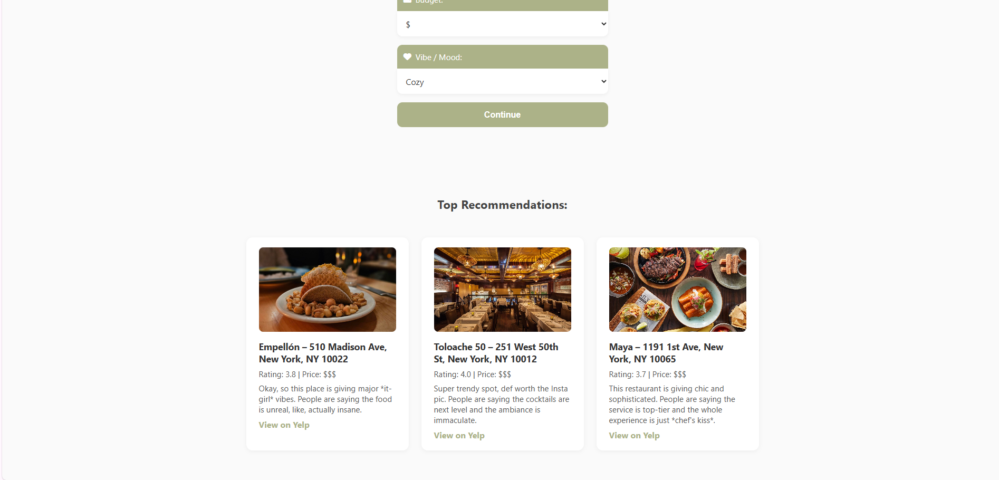
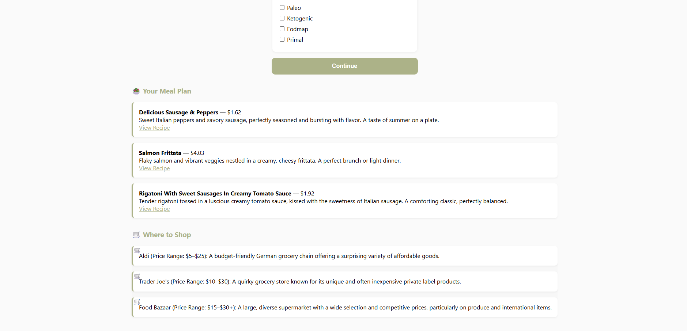
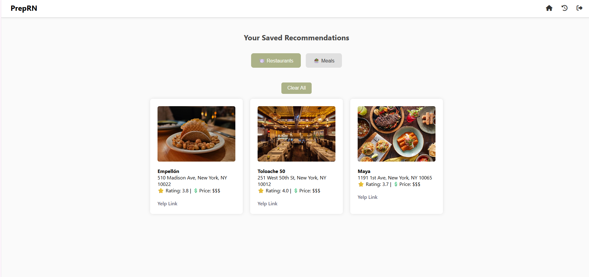

# PrepRN

A full-stack meal-planning and restaurant-discovery application built during the SEO Tech Developer program.

PrepRN connects two decisions in one interface: **what to cook** and **where to eat**. It combines external food APIs with a modular Flask backend, a SQLite database, and server-rendered pages.

## Features

- Restaurant search by location, cuisine, price, and preferences using Yelp.
- Meal suggestions using Spoonacular, dietary restrictions, budget, and pantry ingredients.
- Generated descriptions through Gemini, with fallback text when generation fails.
- Accounts, saved recommendations, favorites, and personal notes.
- Pantry and dietary-preference management.
- Optional distance information through Geoapify.

## Architecture

```text
Browser → Flask routes / Jinja templates
              ├── shared/       Accounts, pantry, preferences, activity
              ├── FoodiesRN/    Yelp search and restaurant persistence
              ├── prepngo/      Meal planning and persistence
              └── SQLite + external APIs
```

This is one Flask application organized into modules. It does not deploy FoodiesRN and PrepnGo as independent services.

## Run locally

Use Python 3.12, the version used for local verification. Tested dependency versions are recorded in `constraints.txt`.

```bash
git clone https://github.com/riddhimayadav/PrepRN.git
cd PrepRN
python3 -m venv .venv
source .venv/bin/activate
pip install -r requirements.txt
cp .env.example .env
```

Set a unique `SECRET_KEY` and the API keys described in `.env.example`. Then run:

```bash
flask --app app run --port 5000
```

Open [localhost:5000](http://localhost:5000). Tables are initialized when the application starts. Keep the SQLite database and environment files out of version control.

## Screenshots

Screenshots show an earlier interface; some current pages contain additional features.

| Restaurant discovery | Meal planning |
|---|---|
|  |  |



## Verification

```bash
pip install -r requirements-dev.txt
pytest
```

The tests use a temporary database and mocked external services. Running the suite should not use live credentials, incur API costs, or alter an existing account database.

## Deployment and limitations

The previously advertised PythonAnywhere deployment is unavailable. The screenshots and source are the current public demonstration; no live demo is claimed.

API availability and quotas affect searches. Generated descriptions are supplementary text, rather than verified restaurant, pricing, or nutrition information. SQLite is used for this project's local storage; production deployment requires explicit configuration and review.

See [UPGRADING.md](UPGRADING.md) before updating an existing installation, particularly its account data and session-secret configuration.

The older [PrepRN-Full-Stack-App](https://github.com/riddhimayadav/PrepRN-Full-Stack-App) repository is retained for existing links. This repository contains the newer application and its development history.
